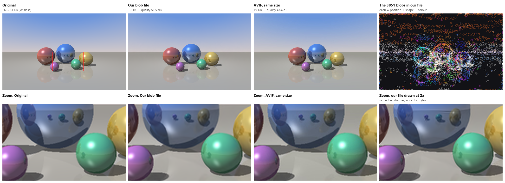
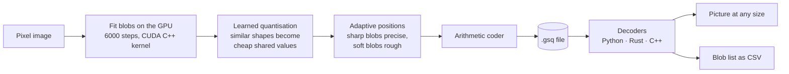
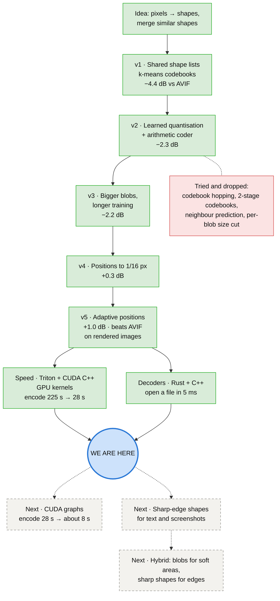
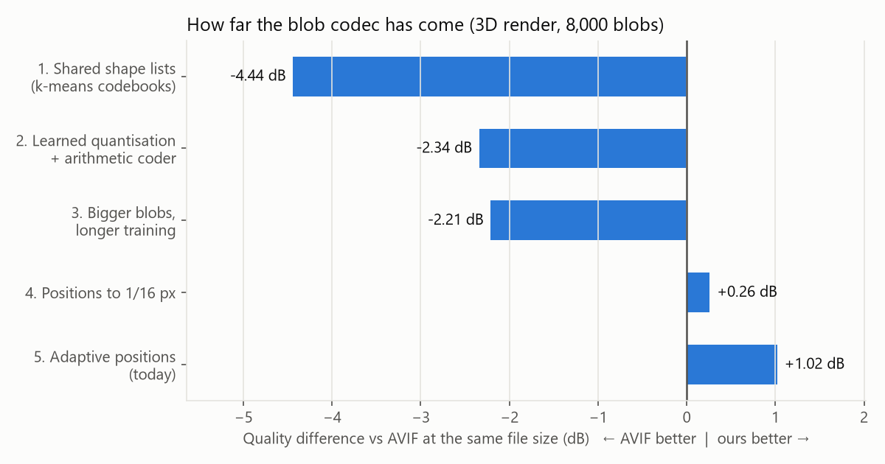
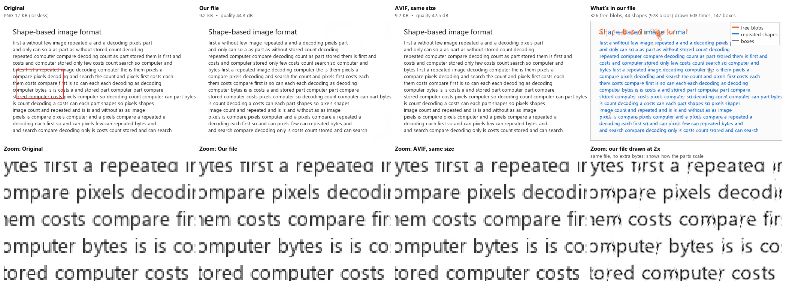

# Vectorization: a try

**Can an image be stored as shapes instead of pixels, so the file is smaller and a computer can work with what's in it directly?**

A normal image stores the colour of every pixel. This project stores an image as a few thousand soft, coloured ellipses ("blobs"). The computer redraws the picture by stacking them. Blobs that look alike share the same shape and colour values, so each one costs only a few bytes.

What you get from storing shapes:
- **Smaller files** for some kinds of images.
- **Any size from one file:** the same file can be drawn at 2× or 4× and stays smooth.
- **Content a program can read:** every blob is a row of numbers (position, size, angle, colour), so a program can count, search or compare them without decoding pixels.

> **Status (Nov 2026):** works end to end, from encoder to file to decoders (Python, Rust, C++).
> On **rendered or artistic images** it beats AVIF, today's best image format, by **7–40%** in file size at equal quality.
> On **natural photos** AVIF still wins by 25–35%, and on **text and screenshots** it loses badly, by 6–10×.

---

## Samples

Three sample images, each at its best setting. Every folder in [`samples/`](samples/) holds:
- the original
- the blob file (`.gsq`)
- the decoded picture
- a **4× render from the same file**
- AVIF at the same size

| Sample | Our file | Best of JPEG / WebP / AVIF for the same quality |
|---|---|---|
| [Glossy spheres](samples/spheres/) (ray-traced here) | **20.8 KB**, 48.6 dB | 28.2 KB → ours **26% smaller** |
| [Colour ribbons](samples/ribbons/) (generated here) | **24.8 KB**, 49.3 dB | 39.7 KB → ours **38% smaller** |
| [Earthrise](samples/earthrise/) (NASA, public domain) | 47.6 KB, 46.9 dB | 16.4 KB → ours **2.9× bigger** (photos are not its strength) |




---

## How it works



Each blob is a 2D Gaussian:

```
pixel(p) = base(p) + Σ colour_i · exp(−½ · dᵀ Σ_i⁻¹ d),   d = p − position_i
```

It stores a position, a shape (3 numbers: width, height and tilt) and a colour (3 numbers). A tiny low-resolution colour grid (`base`) carries the smooth background.

---

## Where we are



**Progress on one image** (a 3D render, 8,000 blobs). Each bar is the quality difference against AVIF at the *same file size*:



---

## Results


| Image type | Result vs AVIF (same quality) |
|---|---|
| 3D renders, glossy or colourful art | ✅ **7–40% smaller** (at 8,000 blobs) |
| Smooth photos (sky, landscape) | ➖ about even at high quality, worse at low quality |
| Natural camera photos | ❌ 25–35% bigger |
| Text, charts, screenshots | ❌❌ 6–10× bigger (even plain PNG is smaller) |

*Measurement note:* the milestone results (v1–v5 and the charts above) measured our quality before rounding the decoded picture to 8-bit pixels, while the other formats were measured after. That flatters us by about 0.1–0.2 dB at 45 dB and about 0.5 dB at 49 dB. `bench.py` now measures everything on the 8-bit picture, and the samples above use that fair measure (`rescore8.py`).

**Why:** soft blobs suit soft things such as gloss, gradients and curves. Text and thin lines have razor-sharp edges, so each letter needs many tiny blobs. In the blob view below you can see them "scribbling" the letters. That's the reason for the *sharp-edge shapes* next step.



### Speed (8,000 blobs, 512×320 image, RTX 5060)

| Step | First version | Now |
|---|---|---|
| Create a file (fit + compress) | about 225 s (PyTorch) | **28 s** (CUDA C++ / Triton kernel) |
| One training step on the GPU | 27 ms (PyTorch) | **2.7 ms** (CUDA C++) |
| Open a file | about 350 ms (Python) | **5 ms** (C++) / 6 ms (Rust) |
| Draw at 4× (2048×1280) | n/a | **0.45 s** (C++, CPU only) |

---

## Repository layout

| Path | What |
|---|---|
| `gsimg/model.py` | Blob image model, fitting, renderer (picks the CUDA, Triton or PyTorch kernel) |
| `gsimg/sq.py` | **Current codec `.gsq`:** learned quantisation, adaptive positions, file format |
| `gsimg/ac.py` | Adaptive arithmetic coder |
| `gsimg/codec.py` | First codec `.gsi` (shared k-means shape lists), kept for comparison |
| `gsimg/tri.py`, `gsimg/cuda_splat.py` | GPU kernels: Triton, and the Python link to the CUDA DLL |
| `gsq_cuda/` | CUDA C++ kernel (`splat.cu`) + `build.bat` |
| `gsq_rs/` | Rust decoder `gsq_view` (`--scale`, `--csv`) |
| `gsq_cpp/` | C++ decoder: single-header `gsq.hpp` + `gsq_view.cpp` |
| `bench.py` | Fit, compress, decode, compare against JPEG / WebP / AVIF |
| `make_charts.py`, `make_figure.py` | The charts and figures in this README |
| `make_tests.py`, `testimgs/` | Synthetic screenshot-type test images |
| `make_samples.py`, `publish_samples.py`, `samples/` | Sample images (ray-traced, generated, NASA) and their best outputs |
| `rescore8.py` | Re-measures saved results on 8-bit pictures (fair PSNR) |
| `results/` | Benchmark numbers for every milestone (JSON) |
| `docs/TECHNICAL.md` | Format details, commands, what was tried |
| `docs/RESEARCH.md` | **Research map:** papers, books and open source from 1980 to 2026, and the ranked next steps |

The photo test images were Windows wallpapers. They're copyrighted, so they aren't included; use your own images.

## Run

```bash
# encode + benchmark (Python 3.12, torch with CUDA; triton-windows optional)
python bench.py my_image.png --n 4000,8000 --lam 0.3,1.0 --tag test

# decode a .gsq anywhere (no Python, no GPU)
gsq_cpp/gsq_view.exe out/my_image_8000_sq_1.0.gsq picture.png --scale 4 --csv blobs.csv
```

Build commands for the Rust, C++ and CUDA parts are in [docs/TECHNICAL.md](docs/TECHNICAL.md).

## Further reading

[docs/RESEARCH.md](docs/RESEARCH.md) maps the related work, from vector quantization (1980) and JBIG2 to GaussianImage, Cool-chic, Beta and triangle splatting, and LLM-to-SVG models (2026). It explains what each could add here and ends with a ranked plan.
