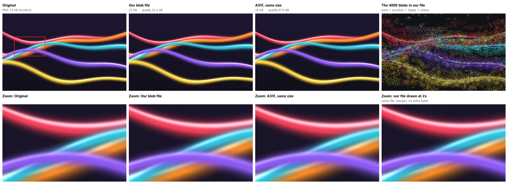
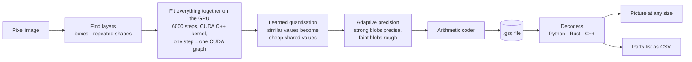
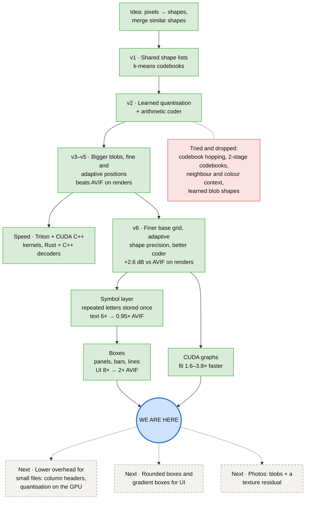
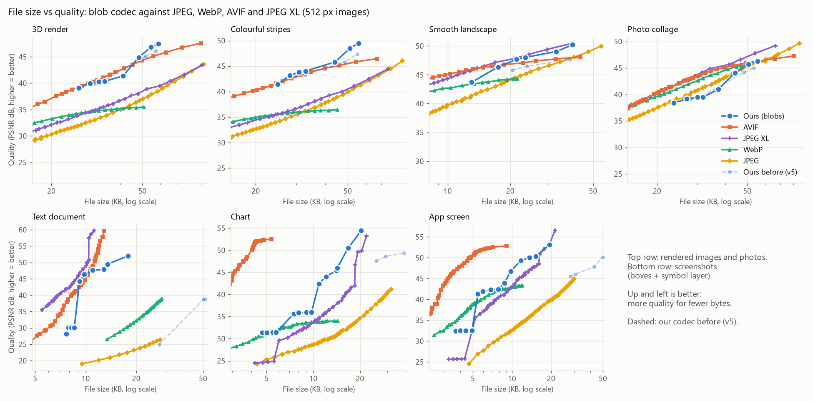
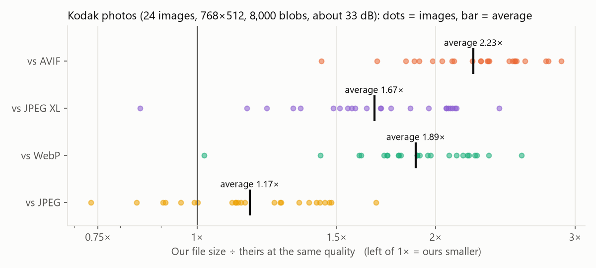
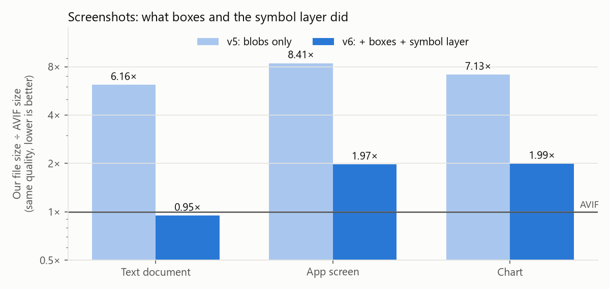
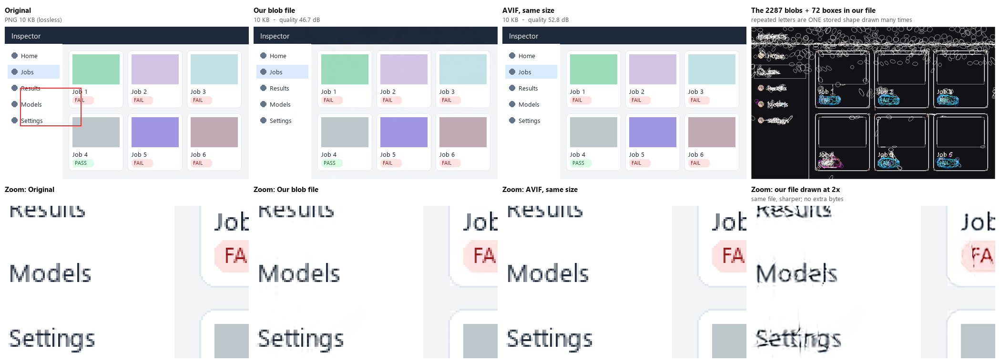

# Vectorization: a try

**Can an image be stored as shapes instead of pixels, so the file is smaller and a computer can work with what's in it directly?**

A normal image stores the colour of every pixel. This project stores an image as layers of simple parts:
- **soft coloured ellipses** ("blobs") for gloss, gradients and curves;
- **boxes** for flat panels, bars and thin lines;
- a **symbol layer** for shapes that repeat, such as letters and icons. Each one is stored once and drawn wherever it appears.

The computer redraws the picture by stacking these parts.

What you get from storing shapes:
- **Smaller files** for some kinds of images.
- **Any size from one file:** the same file can be drawn at 2× or 4×.
- **Content a program can read:** every part is a row of numbers (position, size, angle, colour), and every repeated letter points to the same stored shape. A program can count, search or compare them without decoding pixels.

> **Status (27 Nov 2026):** works end to end, from encoder to file to decoders (Python, Rust, C++). Compared at equal quality against AVIF and JPEG XL, today's best image formats:
> - **Rendered and artistic images:** **10–50% smaller** than the best of them at high quality; on some, none of them reaches our quality at any size.
> - **Text screenshots:** about **5% smaller than AVIF** at 44–46 dB. That's down from 6× bigger before the symbol layer. Our files are still 7–8% bigger than JPEG XL's.
> - **UI screens and charts:** **2–4× AVIF's size**, down from 7–8×, but 15–40% smaller than lossy JPEG XL.
> - **Natural photos:** AVIF still wins clearly; on the Kodak set our files are 2.2× AVIF's size.

---

## Samples

Four sample images, each at its best setting. Every folder in [`samples/`](samples/) holds:
- the original
- the file (`.gsq`)
- the decoded picture
- a **4× render from the same file**
- AVIF at the same size

| Sample | Our file | Best of JPEG / WebP / AVIF / JPEG XL for the same quality |
|---|---|---|
| [Colour ribbons](samples/ribbons/) (generated here) | **24.8 KB**, 52.3 dB | none of them reaches 52.3 dB at any size; **+3.3 dB** over the best at our size |
| [Glossy spheres](samples/spheres/) (ray-traced here) | **18.5 KB**, 51.5 dB | JPEG XL 18.4 KB: about even |
| [Text document](samples/doc/) (drawn here) | **9.2 KB**, 44.1 dB | AVIF needs 9.6 KB; JPEG XL needs only 8.5 KB |
| [Earthrise](samples/earthrise/) (NASA, public domain) | 45.0 KB, 48.2 dB | 19.6 KB: ours 2.3× bigger (photos are not its strength) |




---

## How it works



```
pixel = base_grid(p)                                  tiny colour grid for the smooth background
      + Σ boxes   colour_b  · [p inside box b]        flat panels, bars, 1 px lines
      + Σ blobs   colour_i  · exp(−½ · dᵀ Σ_i⁻¹ d)    soft ellipses, d = p − position_i
      + Σ copies  (the blobs of one stored shape, moved to where the copy is)
```

- **Blob:** a position, a shape (width, height and tilt) and a colour.
- **Box:** four whole-pixel numbers and a colour.
- **Symbol copy:** just a shape number and a position, which can be a fraction of a pixel, unlike pixel-based symbol dictionaries such as JBIG2.

All layers are trained together, so a stored letter shape learns from every copy of itself. On the text sample, 617 letters became 44 stored shapes.

---

## Where we are



**Progress on one image** (a 3D render, 8,000 blobs). Each bar is the quality difference against AVIF at the *same file size*:


*Measurement note:* milestones 1–5 measured our quality before rounding the decoded picture to 8-bit pixels, while the other formats were measured after. That flatters us by about 0.1–0.5 dB. Milestone 6 and everything below use the fair 8-bit measure, so the real step from 5 to 6 is a little larger than shown.

---

## Results



| Image type | Result at the same quality |
|---|---|
| 3D renders, glossy or colourful art | ✅ **11–50% smaller** than AVIF at high quality; JPEG XL is far behind on these. At low quality AVIF wins. |
| Smooth photos (sky, landscape) | ➖ ours 7–21% bigger than JPEG XL at high quality; AVIF much smaller at low quality |
| Natural camera photos | ❌ 20–70% bigger than the best of them |
| Text documents | ✅ about 5% smaller than AVIF at 44–46 dB; ❌ 7–18% bigger than JPEG XL |
| UI screens, charts | ❌ 2–4× AVIF; ✅ 15–40% smaller than lossy JPEG XL |

Two honest caveats:
- **Lossless beats lossy on synthetic screenshots.** Lossless JPEG XL stores the test screenshots in 4–6 KB, smaller than any of our files above about 35 dB. For pixel-exact screenshots, use a lossless format. The blob file's strengths there are the parts list and drawing at any size.
- **Photos lose.** On the standard **Kodak set** (24 photos, 768×512, 8,000 blobs, about 33 dB) our files are 2.2× AVIF's size, 1.7× JPEG XL's, 1.9× WebP's and 1.2× JPEG's:



### Screenshots: what boxes and the symbol layer did





### Speed (RTX 5060)

| Step | First version | Now |
|---|---|---|
| One fitting step (8,000 blobs) | 27 ms (PyTorch) | **3.1 ms** (CUDA C++ kernel + CUDA graph) |
| Fit with boxes + symbols (2,000 steps) | 27.6 s | **7.2 s** |
| Quantise + write a Kodak photo (768×512, after fitting) | n/a | about 21 s |
| Open a file | about 350 ms (Python) | **5 ms** (C++) / 6 ms (Rust) |
| Draw at 4× (2048×1280) | n/a | about 0.5 s (C++, CPU only) |

---

## Repository layout

| Path | What |
|---|---|
| `gsimg/model.py` | Blob model, renderer (CUDA, Triton or PyTorch kernel), CUDA-graph fitting loop |
| `gsimg/rects.py` | **Boxes:** finding flat regions and lines; exact renderer |
| `gsimg/symbols.py` | **Symbol layer:** finding repeated shapes; the layered model and its fit |
| `gsimg/sq.py` | **Codec `.gsq`:** learned quantisation, adaptive precision, the `GSQ4` file format |
| `gsimg/ac.py` | Adaptive arithmetic coder |
| `gsimg/codec.py` | First codec `.gsi` (shared k-means shape lists), kept for comparison |
| `gsimg/tri.py`, `gsimg/cuda_splat.py`, `gsq_cuda/` | GPU kernels: Triton, and the CUDA C++ kernel (Gaussian and Beta blobs) |
| `gsq_rs/` | Rust decoder `gsq_view` (`--scale`, `--csv`) |
| `gsq_cpp/` | C++ decoder: single-header `gsq.hpp` + `gsq_view.cpp` |
| `bench.py` | Fit, compress, decode, compare against JPEG / WebP / AVIF / JPEG XL (`--symbols` for boxes + symbols, `--beta`) |
| `make_charts.py`, `make_figure.py` | The charts and figures in this README |
| `make_tests.py`, `testimgs/` | Synthetic screenshot test images |
| `make_samples.py`, `publish_samples.py`, `samples/` | Sample images and their best outputs |
| `exp_*.py` | Experiments: quantisation loss breakdown, rate model, learned shapes, symbols |
| `get_kodak.sh` | Downloads the Kodak test set (not included) |
| `results/` | Benchmark numbers for every milestone (JSON) |
| `docs/TECHNICAL.md` | Format details, commands, everything tried |
| `docs/RESEARCH.md` | **Research map:** papers, books and open source from 1980 to 2026 |

Some photo test images (img27, img50, img102, img103) were Windows wallpapers. They're copyrighted, so they aren't included; use your own images.

## Run

```bash
# encode + benchmark (Python 3.12, torch with CUDA; triton-windows and pillow-jxl-plugin optional)
python bench.py my_image.png --n 4000,8000 --lam 0.2,0.8 --tag test
python bench.py my_screenshot.png --n 1000,2000 --lam 0.02,0.05 --symbols --tag test

# decode a .gsq anywhere (no Python, no GPU)
gsq_cpp/gsq_view.exe out/my_image_8000_sq_0.8.gsq picture.png --scale 4 --csv blobs.csv
```

Build commands for the Rust, C++ and CUDA parts are in [docs/TECHNICAL.md](docs/TECHNICAL.md).

## Further reading

[docs/RESEARCH.md](docs/RESEARCH.md) maps the related work, from vector quantization (1980) and JBIG2 to GaussianImage, Cool-chic, Beta and triangle splatting, and LLM-to-SVG models (2026). It explains what each could add here.
