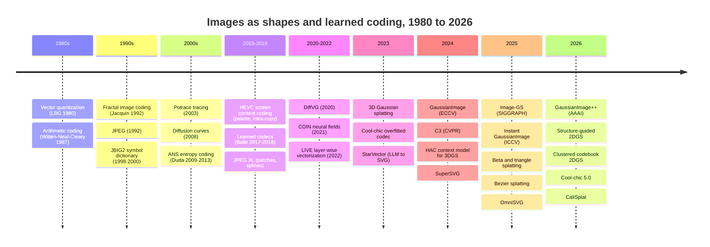

# Research map: what can help this project

Papers, books and open-source code related to *storing images as shapes*, from the 1980s to late 2026. Each entry says **what it offers this project**. A ranked plan is at the end.

Recent preprints (2025–2026) are summarised from their abstracts; their full result tables were not checked here.

---

## 1. Timeline

---

## 2. The closest relatives: images as 2D Gaussians

These are the papers to read first, because they're the same idea as this repo.

| Work | Year | What it is | What it offers us |
|---|---|---|---|
| **GaussianImage**, Zhang et al., ECCV ([arXiv 2403.08551](https://arxiv.org/abs/2403.08551), [code](https://github.com/Xinjie-Q/GaussianImage)) | 2024 | The founding 2D Gaussian codec. It sums Gaussians instead of alpha blending (as we do), with 8 parameters per Gaussian, and decodes at about 1000–2000 FPS. RD is comparable to COIN/COIN++. It uses ANS entropy coding. | Our baseline family. Their numbers are a sanity check for ours. |
| **Image-GS**, Zhang et al., SIGGRAPH ([arXiv 2407.01866](https://arxiv.org/abs/2407.01866), [code](https://github.com/NYU-ICL/image-gs)) | 2025 | Content-adaptive placement by gradient magnitude, error-guided progressive optimisation giving a **level-of-detail hierarchy**, and 0.3K MACs per pixel with random access. Also texture compression. | **Progressive/LOD files:** send coarse blobs first, then refine. Random-access decoding suits large images. |
| **Instant GaussianImage**, ICCV ([arXiv 2506.23479](https://arxiv.org/abs/2506.23479), [code](https://github.com/whoiszzj/Instant-GI)) | 2025 | A network predicts blob placement and attributes in **one pass**, then a short fine-tune. Matches GaussianImage with far fewer iterations. | **Encoder speed:** cuts our 6000-step fit. |
| **GaussianImage++**, AAAI ([arXiv 2512.19108](https://arxiv.org/abs/2512.19108)) | 2025/26 | Distortion-driven densification, context-aware filters, **attribute-separated learnable scalar quantisers + QAT**. The authors concede RD is not yet state of the art. | Confirms our direction (we built the same quantiser idea independently). Densification ideas could replace our "move weakest 3%". |
| **Structure-guided allocation**, Liang et al. ([arXiv 2512.24018](https://arxiv.org/abs/2512.24018)) | 2025 | Blob count *and* precision follow image structure; **adaptive bitwidth for covariance**. Reports −43% BD-rate vs GSImage on Kodak. | Extends our adaptive *position* precision to **adaptive shape precision**. |
| **Clustered Codebook Quantisation (CGVQ)** ([arXiv 2607.05667](https://arxiv.org/abs/2607.05667)) | 2026 | K-means clusters by appearance and anisotropy, with **a codebook per cluster**. 1.92 vs 2.40 bpp vs GaussianImage at equal PSNR. | Our v1 used one global codebook and lost. **Per-cluster codebooks** might make "merge similar shapes" work. |
| **CaliSplat** ([arXiv 2611.04413](https://arxiv.org/abs/2611.04413)), **Fast 2DGS** ([arXiv 2512.12774](https://arxiv.org/abs/2512.12774)), Sobel-gradient init ([arXiv 2610.25809](https://arxiv.org/abs/2610.25809)) | 2025–26 | 3–15× faster fitting; a deep prior for initialisation; classical gradients as init targets. | Encoder speed. We already initialise from Sobel gradients, which this work validates. |
| **GSVC** ([arXiv 2501.12060](https://arxiv.org/abs/2501.12060)) | 2025 | 2D Gaussians for **video**, compared against VVC. | If this grows into video: reuse blobs across frames. |

Not found: searches for "Large Images are Gaussians" and "SmartSplat" returned nothing, so they may not exist under those names.

---

## 3. Better entropy coding: the biggest untapped lever

We measured that a blob's values are **not** predictable from its nearest neighbours' raw values (order-0 coding was as good). Learned **context models** do something stronger: a small network predicts each value's probability from learned features at that location.

| Work | What it offers us |
|---|---|
| **Ballé et al.**: *End-to-end optimized image compression* (ICLR 2017), *Scale hyperprior* (ICLR 2018); Minnen et al. (NeurIPS 2018); *Nonlinear Transform Coding* survey (IEEE JSTSP 2021) | The theory behind our `bits + λ·MSE` training. A hyperprior is a learned side channel that sharpens the probabilities. |
| **HAC / HAC++** for 3D Gaussians ([HAC arXiv 2403.14530](https://arxiv.org/abs/2403.14530), [HAC++ arXiv 2501.12255](https://arxiv.org/abs/2501.12255)) | A **hash-grid context**: query a small learned grid at each blob's position to predict its attributes' distribution, plus adaptive quantisation. Reports over 100× vs plain 3DGS. Port this to 2D: our attribute bits (about 70% of the file) are exactly what it targets. |
| **Cool-chic** (Orange, [arXiv 2212.05458](https://arxiv.org/abs/2212.05458), [5.0: arXiv 2605.02726](https://arxiv.org/abs/2605.02726)), **C3** (Kim et al., CVPR 2024), *Overfitted image coding at reduced complexity* ([arXiv 2403.11651](https://arxiv.org/abs/2403.11651)) | The strongest **overfitted per-image codecs**: per-image latent grids + a tiny auto-regressive entropy model + upsampler. VVC-level RD at about 2000 MAC/pixel. Cool-chic 5.0 is competitive with MLIC++ at 250× lower decode cost. The **best target to measure against**, and a candidate partner in a hybrid (latent grid for texture + blobs for structure). Open source: [Orange-OpenSource/Cool-Chic](https://github.com/Orange-OpenSource/Cool-Chic). |
| **COIN / COIN++** (Dupont et al. 2021/2022) | Early neural-field codecs; the baseline GaussianImage compares against. |
| **ANS** (Duda, [arXiv 1311.2540](https://arxiv.org/abs/1311.2540)) and the **`constriction`** library (Bamler; Rust + Python) | Faster entropy coder than our arithmetic coder, with ready-made learned-model coding. |
| **CompressAI** (InterDigital, PyTorch) | Reference learned codecs + entropy bottleneck layers. Useful as stronger baselines than JPEG/WebP/AVIF. |

---

## 4. Sharp edges, text and screenshots: where soft blobs lose

Our measured weakness is 6–10× worse than AVIF on text. These works attack exactly that.

| Work | What it offers us |
|---|---|
| **Deformable Beta Splatting**, SIGGRAPH 2025 ([arXiv 2501.18630](https://arxiv.org/abs/2501.18630), [page](https://rongliu-leo.github.io/beta-splatting)) | Replace the Gaussian with a **Beta kernel**: bounded support, and one shape parameter sets soft↔hard falloff. Reports sharp edges and flat regions with 45% of 3DGS's parameters. **The smallest change to our code with the biggest expected effect on edges.** |
| **Triangle Splatting** (Held et al. 2025, [arXiv 2505.19175](https://arxiv.org/abs/2505.19175)), 2D Triangle Splatting ([arXiv 2506.18575](https://arxiv.org/abs/2506.18575)), Convex Splatting | Polygon primitives with a learnable edge softness. Natural for UI rectangles and letter strokes. |
| **Bézier Splatting** ([arXiv 2503.16424](https://arxiv.org/abs/2503.16424)) | Differentiable Bézier curves rendered via Gaussian splatting, 30–150× faster per step than DiffVG. **True vector strokes** we could optimise with our pipeline. |
| **JBIG2** (ITU-T T.88; Howard et al., IEEE TCSVT 1998) | The classic "repeated symbols stored once" design: **dictionary + per-instance refinement**. This is the original idea behind this project. Its lesson, the Xerox bug, is to always code a residual so a near-match never silently replaces a different symbol. |
| **JPEG XL** patches and splines ([overview arXiv 2506.05987](https://arxiv.org/abs/2506.05987), [libjxl](https://github.com/libjxl/libjxl)) | **Patches:** repeating content such as letters is coded once and placed many times. **Splines:** thin strokes as centripetal Catmull-Rom curves with varying colour and width. Both are proven designs for our "sharp shapes" mode. |
| **HEVC Screen Content Coding** (palette mode, intra block copy; overview IEEE TCSVT 2016) | **Palette mode:** a few colours with sharp edges become indices into a small palette. **Intra block copy:** reuse an already-decoded block. Cheap wins for UI and charts. |

---

## 5. Turning pixels into real vector graphics (SVG)

These are for the "computer can understand the content" goal: editable shapes, not just compression.

| Work | Year | What it offers us |
|---|---|---|
| **Potrace** (Selinger 2003), **VTracer** (visioncortex, open source) | 2003 / 2020s | Classic bitmap→curve tracing. Fast, good for flat-colour logos. Useful as a baseline and an initialiser for sharp regions. |
| **Diffusion Curves** (Orzan et al., SIGGRAPH 2008) | 2008 | Curves carrying colours on each side, with smooth fill by diffusion. Sharp edges plus smooth gradients in one primitive. A strong idea for our hybrid. |
| **DiffVG** (Li et al., SIGGRAPH Asia 2020, [code](https://github.com/BachiLi/diffvg)) | 2020 | Differentiable rasteriser: optimise SVG paths by gradient descent. The foundation for everything below. |
| **LIVE** (Ma et al., CVPR 2022) | 2022 | Layer-wise path initialisation gives compact, topology-preserving SVG. Slow. |
| **SuperSVG** (Hu et al., CVPR 2024, [arXiv 2406.09794](https://arxiv.org/abs/2406.09794)) | 2024 | Superpixels → coarse-to-fine vector paths with a network. Fast feed-forward vectorisation. |
| **StarVector** (CVPR 2025, [arXiv 2312.11556](https://arxiv.org/abs/2312.11556)), **OmniSVG** ([arXiv 2504.06263](https://arxiv.org/abs/2504.06263), [weights](https://huggingface.co/OmniSVG/OmniSVG)) | 2023–25 | Vision-language models that write **SVG code** (primitives, text elements) from an image. Semantic and compact for icons and diagrams. Not lossless-faithful, but excellent for "understand the content". |

---

## 6. Classic compression ideas (the "past")

| Work | What it offers us |
|---|---|
| **Vector quantization**: Linde, Buzo, Gray (IEEE Trans. Commun. 1980); book *Vector Quantization and Signal Compression* (Gersho & Gray 1992) | Theory for our shared codebooks: why one global codebook underperformed, and how entropy-constrained VQ fixes it. |
| **Fractal image coding**: Jacquin (IEEE TIP 1992); book *Fractal Image Compression* (Fisher, ed., 1995) | The first "reuse similar shapes inside one image" codec. Encoding was very slow and it lost to JPEG, which shows why self-similarity alone is not enough. |
| **Arithmetic coding**: Witten, Neal, Cleary (CACM 1987) | The coder in `gsimg/ac.py`. |
| **JPEG** (Wallace, CACM 1991), **JPEG 2000** (Taubman & Marcellin, book 2002) | Transform coding baselines. JPEG 2000's embedded/progressive bitstream is a model for a progressive `.gsq`. |

---

## 7. Books

| Book | Why read it |
|---|---|
| Khalid Sayood, *Introduction to Data Compression* (5th ed., 2017) | Quantisation, VQ, entropy coding, transform coding: the whole toolbox in one place. |
| Thomas Cover & Joy Thomas, *Elements of Information Theory* (2nd ed., 2006) | Rate-distortion theory: what "bits vs quality" really means. |
| David MacKay, *Information Theory, Inference, and Learning Algorithms* (2003, free online) | Arithmetic coding and probabilistic modelling, very readable. |
| David Salomon & Giovanni Motta, *Handbook of Data Compression* (5th ed., 2010) | Encyclopedic: JBIG2, fractal, VQ, every classic method. |
| Allen Gersho & Robert Gray, *Vector Quantization and Signal Compression* (1992) | The VQ reference. |
| Richard Szeliski, *Computer Vision: Algorithms and Applications* (2nd ed., 2022, free online) | Segmentation, edges, image formation: for sharp-shape detection. |
| Rafael Gonzalez & Richard Woods, *Digital Image Processing* (4th ed., 2018) | Fundamentals: filtering, edges, colour spaces. |

---

## 8. Open-source code worth using

| Project | Use |
|---|---|
| [GaussianImage](https://github.com/Xinjie-Q/GaussianImage), [Image-GS](https://github.com/NYU-ICL/image-gs), [Instant-GI](https://github.com/whoiszzj/Instant-GI) | Reference 2D Gaussian codecs: compare our numbers on Kodak, borrow init/densification. |
| [gsplat](https://github.com/nerfstudio-project/gsplat) (Apache-2.0) | Fast CUDA tile rasteriser with 2D Gaussian support. Faster kernels than ours at high blob counts. |
| [Cool-Chic](https://github.com/Orange-OpenSource/Cool-Chic) | The strongest open overfitted codec: baseline and hybrid partner. |
| [CompressAI](https://github.com/InterDigitalInc/CompressAI), `constriction` | Learned-codec baselines; entropy models and ANS coding. |
| [libjxl](https://github.com/libjxl/libjxl), libavif/libaom, SVT-AV1 | Strong classic baselines (JPEG XL is missing from our charts). |
| [DiffVG](https://github.com/BachiLi/diffvg), VTracer, Potrace, [OmniSVG](https://github.com/OmniSVG) | Vectorisation for sharp/flat regions. |

---

## 9. Plan: what to do next, ranked

| # | Step | Based on | Expected effect | Effort |
|---|---|---|---|---|
| 1 | **Beta kernel** instead of Gaussian (one extra shape number per blob) | Deformable Beta Splatting | Sharper edges, fewer blobs. Big gain on text/UI, some on renders. | Small: kernel + 1 attribute |
| 2 | **Hash-grid / latent context model** for attribute coding | HAC, Cool-chic/C3 | Fewer bits for the ~70% of the file that is attributes. Likely the biggest RD gain on photos. | Medium |
| 3 | **Adaptive shape precision** (per-blob bitwidth, like our positions) | Structure-guided 2DGS | Fewer bits on soft blobs. | Small |
| 4 | **Patch dictionary + residual** for repeated content (letters, icons) | JBIG2, JPEG XL patches, HEVC IBC | The original "store similar shapes once" idea, done safely. Big gain on text/UI. | Medium |
| 5 | **Fast init** (feed-forward or better densification) + **CUDA graphs** | Instant-GI, CaliSplat, GaussianImage++ | Encode 28 s → a few seconds. | Medium |
| 6 | **Fair baselines:** add JPEG XL and Cool-chic; test on **Kodak** | libjxl, Cool-chic | Honest standing against the field. | Small |
| 7 | **Hybrid:** latent grid (texture) + blobs (soft structure) + curves (sharp edges) | Cool-chic, Bézier splatting, Diffusion curves | The long-term "best of all" format. | Large |
